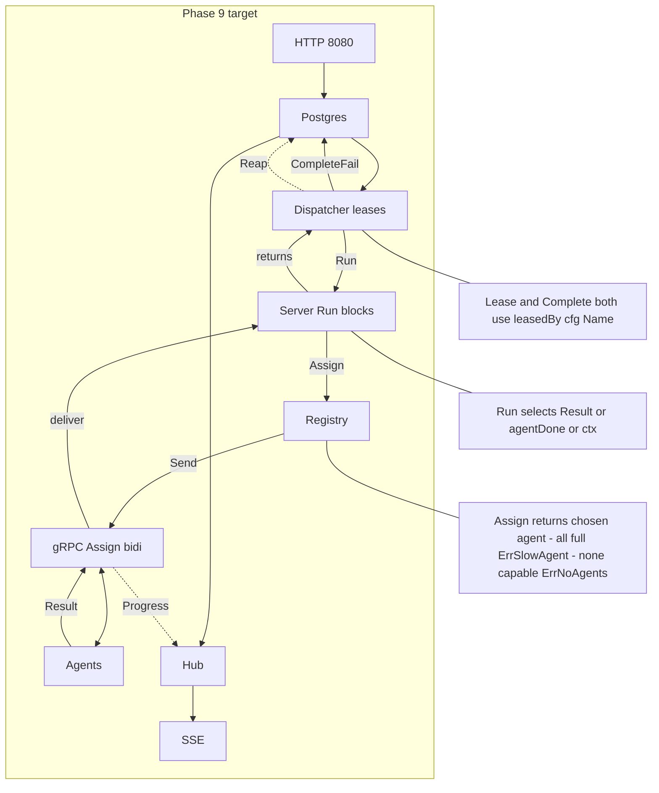
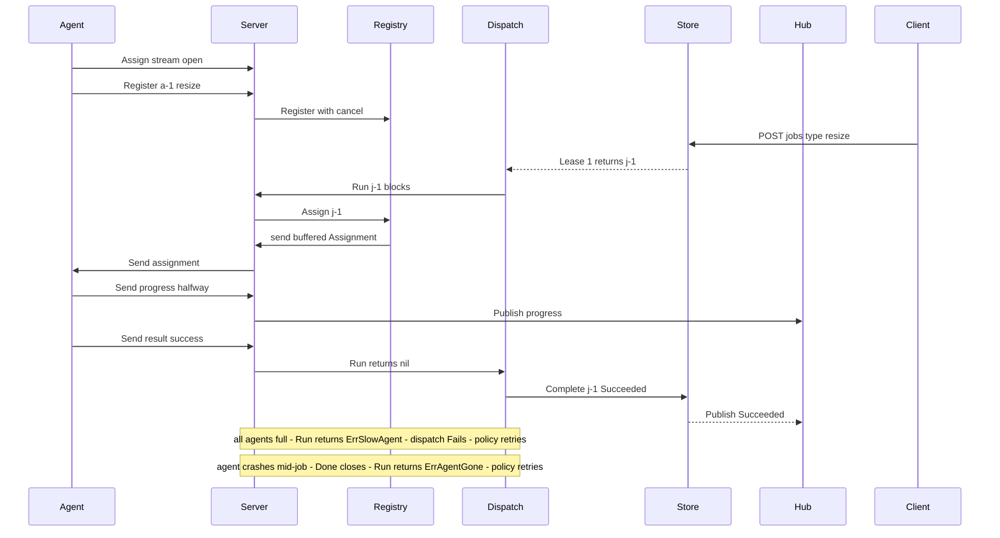
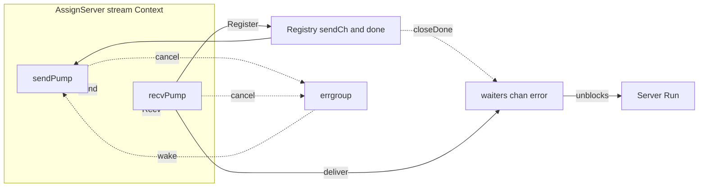

# Phase 9 — gRPC server, registry, and the two-pump stream

**Goal:** `conveyord` accepts agents over a long-lived bidirectional gRPC stream, hands each assignment it leased, and records what the agent sends back — without the dispatch loop knowing agents exist.

*Done when:* `buf` regenerates a `Conveyor.Assign` service, `go test -race ./...` proves a fake agent can receive an `Assignment`, send `Progress`/`Result`, and that a second agent never gets the same job, and `conveyord` serves gRPC alongside HTTP under one `errgroup` root with `GracefulStop` on SIGTERM.

---

## How to read this plan

Same contract as phases 7–8: **tests and configs are given verbatim; implementation is requirements and hints.** Where two answers are defensible the options are argued. Part 0 is a primer — read it first, every task refers back to a numbered section.

---

## Corrections applied 2026-09-01 (post-review)

Eight findings from the phase review changed the design. Read these before the tasks; the task text below already reflects them.

1. **The runner blocks on the `Result`.** The original Task 4 had `rpcRunner.Run` return `nil` immediately after `reg.Assign`. `dispatch.runOne` records the outcome the moment `Run` returns (`dispatch.go:162`), so every agent job would be written `Succeeded` at assignment time, before the agent read the frame — and the agent's real `Result` would then miss `completeJobSQL`'s `WHERE … state = 'leased'` (`store.go:284`) and be dropped as `ErrNotFound`. `Run` now waits for the `Result`, the agent's disconnect, or `ctx` — whichever comes first.
2. **`internal/rpc` never touches the store.** Consequence of (1): dispatch already owns recording, with the correct `leased_by = cfg.Name` fencing. The `rpc.Store` subset, the "relax `WHERE leased_by`" change to `internal/store` (which no task ever scheduled), and the documented "stale agent completes a reaped job" hole are all deleted.
3. **Registration happens on the `Register` frame, inside `recvPump`.** No pre-`Recv` `peerID`: two readers of one stream deadlock against any agent that doesn't identify itself first, including this plan's own tests and `grpcurl` demo. An unidentified agent is simply never assigned anything — which is also the only honest answer for capability filtering.
4. **`Unregister` is identity-checked.** A displaced agent's deferred `Unregister(id)` would otherwise evict the replacement that displaced it.
5. **Shutdown cancels streams before `GracefulStop`.** `GracefulStop` waits for open RPCs; a bidi stream never ends on its own, so the original Task 4 could not exit on SIGTERM.
6. **Waiters wake on disconnect.** Consequence of (1) that the first correction missed: with `Run` blocked on the `Result` channel alone, a crashed agent hangs it forever. `jctx` is only cancelled by shutdown or `ErrLeaseLost`, and the renewal pump renews under `cfg.Name` regardless of agent liveness (`dispatch.go:121-141`) — so the lease never expires, the reaper never fires, `runOne` never returns, and the `MaxInFlight` slot is gone for the life of the process. `Registry.Assign` now returns the `*Agent` and `Run` selects on `Agent.Done()` too, with keepalive (Task 4) to bound the black-holed-TCP case.
7. **Re-`Register` on a live stream mutates capabilities; it never re-registers.** The second-order bug in (6): with `done` now load-bearing, routing a capability update through `Register` would `close(old.done)` and fail every job that agent is running with `ErrAgentGone` — and because `cancel` is per-stream, `old.cancel()` would be *this* stream's cancel, so the agent would also disconnect itself. `Registry.SetCapabilities` mutates in place under `mu`, `capabilities` is unexported so nothing outside can race it, and identity is first-Register-wins.
8. **Results carry an attempt token.** The last member of the 1/6/7 family. `runOne` abandons an attempt on `ErrLeaseLost` (`dispatch.go:134`) while that agent keeps working — phase 9 has no `CancelJob` — and the store increments `attempt` on `Fail` (`store.go:378`), so attempt 2 is in flight before attempt 1 reports. A waiter keyed on `job_id` alone hands attempt 1's error to attempt 2 and buries a job another agent is finishing. `Assignment.attempt = 4` and `Result.attempt = 3` are additive, `Registry.Assign` stamps `j.Attempt`, and `Server.waiters` is keyed by `(jobID, attempt)`. Global constraint 4 is now true rather than aspirational.

## Global constraints

Carried from phases 7–8, plus:

1. **No fire-and-forget `go`.** Every `go` in `internal/rpc` has a written owner, a written stop signal, and a written destination for its error. Phase 7's rule, enforced harder here because streams own goroutines that outlive `Assign`'s return.
2. **`internal/rpc` owns no SQL.** It talks to interfaces it declares. The registry is in-memory, dispatch stays on `store.Store`, and `Store` remains the only package that imports `pgx`.
3. **Errors cross the stream as `Result.error string`, not gRPC codes.** A `Result` with `error==""` is success, otherwise failure, and `Server.Run` turns that string into the `error` dispatch records. No `job.ErrNotFound`/`ErrInvalidTransition` mapping appears in `internal/rpc` at all — that mapping belongs to whoever calls the store, and after the corrections above, this package never does. `Assign` itself returns only transport reality: `nil` for a client that went away, the `Send`/`Recv` error otherwise.
4. **At-least-once still holds — via the stream, not via the lease.** An agent dying mid-stream never loses a job, but the lease is not what saves it: the dispatcher renews leases on a ticker with no knowledge of agent liveness, so a dead agent's lease outlives the agent (see §0.4). The guarantee is that a disconnect wakes the runner, which reports a retryable failure while it still holds the lease. The server never "completes" a job on behalf of an agent.
5. `buf` remains the contract. Editing `gen/` is a review finding.

---

## Part 0 — The primer

All programs below were run before writing this. Outputs are real.

### 0.1 Bidirectional streaming is one RPC that never returns

```protobuf
service Conveyor {
  rpc Assign(stream AgentToServer) returns (stream ServerToAgent);
}
```

One call, two streams, same TCP connection. The server reads with `stream.Recv()` and writes with `stream.Send()` until either side cancels. There is no request/response pair — the first `Progress` from an agent can arrive before the first `Assignment` from the server.

Why not two unary RPCs (`Poll` + `Report`)? An agent polling every second adds average 500 ms latency to `pending→leased` and doubles reconnect logic (what if `Poll` succeeds and `Report` fails?). One stream gives one place to order, cancel, and retry.

### 0.2 The two-pump pattern — and what deadlocks if you don't

A bidi stream has one reader and one writer, but they cannot be the same goroutine that also does work:

```go
// Wrong: one loop cannot both Send and Recv without blocking on itself.
for {
  msg, _ := stream.Recv() // blocks until agent sends — server can't Send
  stream.Send(&pb.ServerToAgent{...})
}
```

The fix is two goroutines:

```go
g, ctx := errgroup.WithContext(stream.Context())
g.Go(func() error { return sendPump(ctx, stream, assignments) })
g.Go(func() error { return recvPump(ctx, stream, send, hub) })
return g.Wait()
```

`sendPump` selects on `assignments <-chan` and `ctx.Done()`; `recvPump` loops on `Recv()` and dispatches `Heartbeat`/`Progress`/`Result`. Either pump returning cancels `ctx` (via `errgroup`), which wakes the other. **One pump returning nil does not cancel** — see phase 7 §0.2 — so both pumps watch `ctx.Done()` and return `ctx.Err()` when it fires.

What happens if you forget `SetLimit`? Nothing — these two goroutines are the only members, `SetLimit` is unnecessary here. Phase 7 needed it for bounding `MaxInFlight`; here the bound is "one stream = two goroutines".

### 0.3 The registry is a mutex, not a channel manager

```go
type Registry struct {
  mu     sync.Mutex
  agents map[string]*Agent // keyed by the agent_id from its Register frame
}
```

An agent registers when its first `Register` frame arrives, unregisters when `Assign` returns. `Assign(job.Job) (*Agent, error)` looks up an idle capable agent and returns the one it chose, or `ErrNoAgents` so the dispatcher can fall back to the retry path rather than blocking. Using a `chan` per agent (`chan *pb.ServerToAgent` size 1, drop-on-full same as hub) keeps `Assign` non-blocking — a slow agent drops an `Assignment`, the runner reports the failure, and the policy retries it, same at-least-once reasoning as SSE.

Returning the agent is not a convenience. The caller has to wait for *that* agent to answer, and an agent's death is the only thing besides a `Result` that can ever release the job — so the registry also gives every agent a `done` channel it closes on the way out. §0.4 and Task 3 spell out why nothing else wakes a blocked runner.

No `sync.Map`, no manager goroutine. `map` + `sync.Mutex` is 4 lines and `go test -race` will find the races you would have hidden behind a channel manager.

### 0.4 Context across the stream

`stream.Context()` is cancelled when the client disconnects **or** when the server returns from `Assign`. Nothing in `internal/rpc` writes to Postgres, so no `context.WithoutCancel` appears here: a `Result` is handed to the waiting `Server.Run` goroutine over a buffered channel — a send that cannot block or be cancelled — and `dispatch.runOne`'s already-detached `recCtx` (`dispatch.go:143`) is what survives SIGTERM to record it.

What the stream context does **not** do is bound the job. `dispatch.runOne`'s `jctx` is cancelled only by shutdown or by a failed lease renewal, and renewal is a ticker that talks to Postgres under `cfg.Name` — it knows nothing about the agent (`dispatch.go:121-141`). So a dead agent's lease is renewed forever, the reaper never sees the job, and a runner blocked only on the `Result` channel is blocked for the life of the process. The stream, not the lease, is the liveness signal in phase 9: the registry closes the agent's `done` channel and the runner wakes.

A `Recv` returning `io.EOF` ends the whole stream: phase 9 does not support half-close. An agent that stops sending stops receiving, so there is no state where a registered agent can be assigned work it can never report on.

### 0.5 `bufconn` and the transcript trap

Testing a bidi stream without a real network:

```go
lis := bufconn.Listen(1 << 20)
srv := grpc.NewServer()
pb.RegisterConveyorServer(srv, myServer)
go srv.Serve(lis)
conn, _ := grpc.NewClient("passthrough://bufnet",
  grpc.WithContextDialer(func(ctx context.Context, _ string) (net.Conn, error) {
    return lis.DialContext(ctx)
  }), grpc.WithTransportCredentials(insecure.NewCredentials()))
client := pb.NewConveyorClient(conn)
stream, _ := client.Assign(ctx)
```

If you buffer a `Result` write and then read an `Assignment`, and both sides use `time.Sleep` to "wait", the test flakes. Synchronize on the return value of `Send`/`Recv`, never on time.

---

## Task 1 — The service

**Goal:** the wire now names the RPC phase 9 will implement.

### Steps

1. Edit `proto/conveyor/v1/conveyor.proto` — add the service block and the minimal agent identity. No other file changes in this task.
2. `make proto`, read `gen/conveyor/v1/conveyor_grpc.pb.go` once — note the `ConveyorClient`/`ConveyorServer` interfaces and that `RegisterService` is generated.
3. `buf lint` + `buf breaking` + `go test ./internal/rpc` must still pass (breaking change is adding a service: allowed per `FILE` rule; adding a variant is also allowed).

### The shape

```protobuf
syntax = "proto3";

package conveyor.v1;

option go_package = "github.com/mddemin/conveyor/gen/conveyor/v1;conveyorv1";

// Added in phase 9: one long-lived stream per agent.
service Conveyor {
  // Assign is the agent's lifeline: the server pushes Assignments,
  // the agent pushes Heartbeats/Progress/Results.
  rpc Assign(stream AgentToServer) returns (stream ServerToAgent);
}

// Existing messages unchanged, except one additive variant:
message AgentToServer {
  oneof payload {
    Heartbeat heartbeat = 1;
    Register  register = 2; // <-- new, occupies reserved gap
    Progress  progress = 5;
    Result    result   = 6;
  }
}

message Register {
  string agent_id    = 1; // client-chosen, e.g. "host-pid"
  repeated string capabilities = 2; // types this agent can execute; empty = any
}

// Added in phase 9 (second pass): the attempt token. Both sides echo it so a
// Result can be matched to the attempt it belongs to, not merely to the job.
message Assignment {
  string job_id  = 1;
  string type    = 2;
  bytes  payload = 3;
  int32  attempt = 4; // job.Job.Attempt at lease time; agents echo it verbatim
}

message Result {
  string job_id  = 1;
  string error   = 2; // empty means success
  int32  attempt = 3; // copied from the Assignment being reported
}

// ServerToAgent, CancelJob, Heartbeat, Progress as in phase 8.
```

**Why the attempt token exists.** A job ID alone does not identify a unit of work. `dispatch.runOne` abandons an attempt whenever lease renewal fails (`cancelJob(ErrLeaseLost)`, `dispatch.go:134`), and phase 9 has no `CancelJob` delivery — so the agent holding attempt 1 keeps working, unaware. The store increments `attempt` on failure (`store.go:378`, and `Fail`'s doc at `store.go:385-386`), the job is re-leased, and attempt 2 goes to another agent. When attempt 1 finally reports, a waiter keyed on `job_id` alone hands agent A's error to agent B's attempt: repeat to `MaxAttempts` and the job is buried while B succeeded. That breaks global constraint 4, and `leased_by` fencing cannot catch it because the dispatcher legitimately holds the lease for attempt 2. `(job_id, attempt)` is the smallest key that identifies one attempt.

Field numbers 4 and 3 are new, so this is additive and `buf breaking` stays green. Note `Attempt` is "completed attempts; zero before the first run" (`job.go:11`), so a first attempt carries `0` — which is also what a client that omits the field sends, keeping the `grpcurl` demo honest without a compatibility branch.

**Decisions worth writing in the PR:**

* **One service, one RPC.** The registry needs only `Assign`. Adding a separate `Heartbeat` RPC would split liveness across two streams and double reconnect logic — see §0.1.
* **`Register` at field 2, not 7.** It fills the gap left in phase 8. A fresh number would waste the reservation and break the "gaps are intentional" story. Adding a variant is non-breaking; reusing a deleted number would be.
* **No auth in phase 9.** `agent_id` is advisory and used as a map key; real auth arrives in phase 11 with OTel/mTLS. Duplicate IDs displace the old connection — the registry cancels the old stream's context and the old handler unwinds. Displacement is the success path, not an error (see Task 2); `AlreadyExists` would force every reconnecting agent to handle a code that means "you already reconnected".

### Done when

Extend `fixtures()` in `internal/rpc/wire_test.go` with `agent_to_server_register` (`Register{agent_id:"a-1", capabilities:["resize"]}`) before regenerating — then `register` appears as `.hex` golden number 7 after `OVERWRITE_GOLDEN=1 go test ./internal/rpc -run TestWireFormatIsFrozen && git add internal/rpc/testdata/*.hex`. `buf lint` passes and `gen/` contains `conveyor.pb.go` + `conveyor_grpc.pb.go`.

The attempt token lands as goldens 8 and 9: add `assignment_with_attempt` (`Assignment{job_id:"j-1", type:"resize", attempt:2}`) and `result_with_attempt` (`Result{job_id:"j-1", attempt:2}`) as *new* fixtures rather than editing the existing ones. A zero field is not encoded, so goldens 1–7 must come back byte-identical — if `git diff internal/rpc/testdata` shows any existing `.hex` changing, the field was added with a reused number and the change is not additive after all. That diff is the cheapest `buf breaking` you own.

---

## Task 2 — The registry

**Goal:** an in-memory, race-safe set of connected agents with non-blocking assignment.

### Shape

```go
package rpc

// Agent holds what the server needs to push to one stream. Every field is
// immutable after Register except capabilities and closed, both guarded by
// Registry.mu — which is why capabilities is unexported: List hands out these
// pointers, and an exported mutable map would be a race waiting for a reader.
type Agent struct {
  ID           string
  capabilities map[string]struct{}    // empty means "any type"; guarded by Registry.mu
  send         chan *pb.ServerToAgent // size 1, drop-on-full — see hub pattern
  cancel       context.CancelFunc     // ends this agent's Assign — per stream, never shared
  done         chan struct{}          // closed when this agent is gone; wakes every waiter at once
  closed       bool                   // guarded by Registry.mu; makes closing idempotent
}

type Registry struct { /* mu + map[string]*Agent */ }

func NewRegistry() *Registry
func (r *Registry) Register(id string, caps []string, send chan *pb.ServerToAgent, cancel context.CancelFunc) *Agent
func (r *Registry) SetCapabilities(a *Agent, caps []string) // re-Register on a live stream
func (r *Registry) Unregister(a *Agent) // identity-checked; always closes a
func (r *Registry) List() []*Agent      // snapshot copy, caller must not mutate
func (r *Registry) Assign(j job.Job) (*Agent, error) // returns the agent it delivered to
func (r *Registry) CloseAll()           // end every stream; shutdown calls this before GracefulStop
func (a *Agent) Done() <-chan struct{}  // read-only view for waiters
var ErrNoAgents = errors.New("no agents available")
var ErrSlowAgent = errors.New("agent is slow")
```

**Requirements:**

* **`Register` is called at most once per stream.** This is the invariant everything else rests on, so Task 3 enforces it: only the *first* `Register` frame reaches `Register`, later ones go to `SetCapabilities`. It matters because `cancel` is per-stream — if `Register` were called twice from one handler, `close(old)` would fire *this* stream's `cancel` and the agent would disconnect itself on a capability update, while `close(old.done)` spuriously failed every job it was running. Displacement is therefore always cross-stream, and `old.cancel()` always ends somebody else's connection.
* `Register` under `mu`. If `id` already exists, close the old agent (below) and replace the entry. Returns the new `*Agent` — no error, because there is no failure mode: displacement *is* the success path, and an `error` that is always `nil` is a lie every caller has to write `_` for.
* `SetCapabilities(a, caps)` rebuilds `a.capabilities` in place under `mu`. No new `*Agent`, no close, no cancel: every waiter holding this pointer keeps waiting, which is the entire point. Mutating in place is safe precisely because `capabilities` is unexported and `Assign` reads it under the same `mu`.
* One internal closer, called with `mu` held, is the only place an agent ends:
  ```go
  func (r *Registry) close(a *Agent) { // caller holds mu
    if a.closed { return }
    a.closed = true
    close(a.done) // broadcast: every waiter on this agent wakes
    a.cancel()    // the stream's Recv/Send return, the handler unwinds
  }
  ```
  Idempotence is not decoration: displacement closes the loser immediately, and the loser's handler still calls `Unregister` on the way out. A second `close(a.done)` panics.

  It is a method on `*Registry`, not on `*Agent`, because `closed` is registry-owned state: `Registry.mu` already guards every mutable field an `Agent` has (`capabilities` and `closed`), so "caller holds `mu`" is a statement about the receiver and there is exactly one synchronization authority. On `*Agent` it would either depend invisibly on another type's mutex — unenforceable, and `a.close()` from anywhere would compile and race — or need its own `sync.Once`, giving one struct two locking regimes for no caller that wants it: `Register`, `Unregister`, and `CloseAll` all already hold `mu`. If phase 10 ever needs a handler to close itself without the registry, that is when `Agent` earns a `Once` and this method moves.

  Note that `a.cancel()` runs under `mu`, so the woken handler blocks in its deferred `Unregister` until the lock is released — correct and brief, but it is why `close` must never be called from a path that holds `mu` for long. `CloseAll` wakes every handler at once and they queue on one mutex; fine at agent-count scale, and worth remembering if agents ever number in the thousands.
* `Unregister(a *Agent)` calls `r.close(a)` unconditionally, then deletes only if `r.agents[a.ID] == a`. Closing unconditionally is what wakes waiters on a displaced agent; the identity check is what stops a displaced handler from evicting the replacement that displaced it.
* `List()` returns a snapshot copy under `mu`; caller must not mutate. Same reason as `hub`'s registry.
* `Assign` holds `mu` for the whole walk and never blocks. It builds **one** envelope before the loop — `&pb.Assignment{JobId: j.ID, Type: j.Type, Payload: j.Payload, Attempt: int32(j.Attempt)}`, and stamping `Attempt` here is what makes the `(job_id, attempt)` waiter key in Task 3 work — then iterates agents; skip any that is `closed`, or whose `capabilities` are non-empty and lack `j.Type`; for each remaining candidate try `select { case a.send <- msg: return a, nil; default: }`. All capable agents full → `nil, ErrSlowAgent`. No capable agent at all → `nil, ErrNoAgents`. The distinction matters to the operator, not the code: both are retried identically by `Policy.OnFailure` (`retry.go:45-49`), so make the messages say which is which — `ErrSlowAgent` means "add agents", `ErrNoAgents` means "nothing can run this type".
* Three details in that sentence are each a bug if dropped. **Holding `mu`:** `Assign` ranges over the map, so an unlocked walk is not a benign race — it is `fatal error: concurrent map iteration and map write`, which no `recover` reaches. **Skipping `closed`:** `CloseAll` closes without deleting, so during shutdown the map is full of doomed agents; assigning to one delivers a frame to a dead stream and burns an attempt. **One envelope:** allocating inside the loop pays for every full agent it walks past, and at most one of those copies is ever received.
* Returning the `*Agent` is the whole point of the signature change: the caller must be able to wait on *that* agent's disappearance, not on "some agent". See Task 3's `Run`.
* `CloseAll` calls `r.close(a)` for every entry under `mu` without deleting: each handler's own deferred `Unregister` does the removal, so shutdown has exactly one owner of map mutation per entry.
* Name the capability loop variable `c`, not `cap` — shadowing a builtin in a 4-line loop earns nothing.

**No `Store`, no `hub`, no `grpc` in this file.** The registry is pure concurrency: it knows channels, capabilities, and cancel funcs. Who leases, who records, and who publishes are all somebody else's problem.

### Tests (verbatim)

```go
func TestRegistryIsConcurrentSafe(t *testing.T) {
  r := NewRegistry()
  var g errgroup.Group
  for i := 0; i < 50; i++ {
    id := fmt.Sprintf("a-%d", i)
    g.Go(func() error {
      a := r.Register(id, nil, make(chan *pb.ServerToAgent, 1), func() {})
      r.Unregister(a)
      return nil
    })
    g.Go(func() error { _, _ = r.Assign(job.Job{ID: id, Type: "x"}); return nil })
    g.Go(func() error { r.CloseAll(); return nil })
  }
  if err := g.Wait(); err != nil { t.Fatal(err) }
  // -race covers the map; this covers the bookkeeping: every Register above is
  // paired with an Unregister, so a leaked entry is a lost cancel func.
  if n := len(r.List()); n != 0 { t.Fatalf("registry not drained: %d agents left", n) }
}

func TestDuplicateIDDisplacesOldStream(t *testing.T) {
  r := NewRegistry()
  cancelled := make(chan struct{})
  old := r.Register("a-1", nil, make(chan *pb.ServerToAgent, 1), func() { close(cancelled) })
  fresh := r.Register("a-1", nil, make(chan *pb.ServerToAgent, 1), func() {})
  <-cancelled // displacement must end the old stream, or it leaks until TCP notices
  <-old.Done() // and must wake anyone waiting on the loser, immediately
  r.Unregister(old) // the displaced handler unwinds late: must not evict fresh, must not double-close
  if got := r.List(); len(got) != 1 || got[0] != fresh {
    t.Fatalf("displaced agent evicted its replacement: %v", got)
  }
}

func TestUnregisterWakesWaiters(t *testing.T) {
  r := NewRegistry()
  a := r.Register("a-1", nil, make(chan *pb.ServerToAgent, 1), func() {})
  select {
  case <-a.Done(): t.Fatal("Done closed while the agent is still registered")
  default:
  }
  r.Unregister(a)
  <-a.Done() // a blocked Run must have exactly this wake-up; hangs here on failure
}

func TestCloseAllWakesWaiters(t *testing.T) {
  r := NewRegistry()
  a := r.Register("a-1", nil, make(chan *pb.ServerToAgent, 1), func() {})
  r.CloseAll()
  <-a.Done()
  if n := len(r.List()); n != 1 { t.Fatalf("CloseAll must not delete; handlers do: %d", n) }
  r.Unregister(a) // idempotent close: this must not panic
}

func TestAssignDropsForSlowAgent(t *testing.T) {
  r := NewRegistry()
  ch := make(chan *pb.ServerToAgent, 1)
  ch <- &pb.ServerToAgent{Payload: &pb.ServerToAgent_Assignment{Assignment: &pb.Assignment{JobId: "blocked"}}}
  r.Register("slow", nil, ch, func() {})
  _, err := r.Assign(job.Job{ID: "j2", Type: "x"})
  if !errors.Is(err, ErrSlowAgent) { t.Fatalf("want ErrSlowAgent, got %v", err) }
}

func TestAssignSkipsFullAgent(t *testing.T) {
  r := NewRegistry()
  full := make(chan *pb.ServerToAgent, 1)
  full <- &pb.ServerToAgent{}
  free := make(chan *pb.ServerToAgent, 1)
  r.Register("full", nil, full, func() {})
  fresh := r.Register("free", nil, free, func() {})
  // Map order is random: this fails whenever Assign returns on the first full
  // agent instead of walking past it.
  got, err := r.Assign(job.Job{ID: "j1", Type: "x"})
  if err != nil { t.Fatalf("free agent should receive, got %v", err) }
  if got != fresh { t.Fatalf("Assign returned the wrong agent: %v", got) }
  if len(free) != 1 { t.Fatal("assignment did not reach the free agent") }
}

func TestCapabilityFiltering(t *testing.T) {
  r := NewRegistry()
  r.Register("img", []string{"resize"}, make(chan *pb.ServerToAgent, 1), func() {})
  if _, err := r.Assign(job.Job{ID: "j1", Type: "resize"}); err != nil { t.Fatalf("capable agent should receive, got %v", err) }
  if _, err := r.Assign(job.Job{ID: "j2", Type: "transcode"}); !errors.Is(err, ErrNoAgents) { t.Fatalf("want ErrNoAgents, got %v", err) }
}

func TestSetCapabilitiesKeepsTheSameAgent(t *testing.T) {
  r := NewRegistry()
  a := r.Register("img", []string{"resize"}, make(chan *pb.ServerToAgent, 1), func() {
    t.Fatal("a capability update must never cancel the stream")
  })

  r.SetCapabilities(a, []string{"resize", "transcode"})

  select {
  case <-a.Done(): t.Fatal("a capability update must not wake waiters")
  default:
  }
  if got := r.List(); len(got) != 1 || got[0] != a {
    t.Fatalf("SetCapabilities replaced the agent: %v", got)
  }
  if _, err := r.Assign(job.Job{ID: "j1", Type: "transcode"}); err != nil {
    t.Fatalf("newly announced type should be assignable, got %v", err)
  }
}
```

---

## Task 3 — The server: two pumps, one `Assign`

**Goal:** a `ConveyorServer` that implements `Assign(stream Conveyor_AssignServer) error`.

### Shape

```go
type Server struct {
  pb.UnimplementedConveyorServer
  hub      Publisher // hub.Publish, same interface store.New takes
  registry *Registry
  log      *slog.Logger

  mu      sync.Mutex
  waiters map[attemptKey]chan error // one attempt -> the Run goroutine blocked on its Result
}

// attemptKey identifies one unit of work. A job ID alone does not: a job
// abandoned by ErrLeaseLost is re-leased while the previous agent is still
// working on it, and phase 9 has no CancelJob to tell that agent to stop. See
// Task 1's "why the attempt token exists".
type attemptKey struct {
  jobID   string
  attempt int32
}

type Publisher interface{ Publish(ev job.Event) }

func NewServer(hub Publisher, reg *Registry, log *slog.Logger) *Server

// Assign is the gRPC handler: one call per connected agent, two pumps.
func (s *Server) Assign(stream pb.Conveyor_AssignServer) error

// Run satisfies dispatch.Runner. It hands j to an agent and blocks until that
// agent reports a Result or ctx dies. Living here, not in package main, is what
// makes it testable without Postgres or a real listener.
func (s *Server) Run(ctx context.Context, j job.Job) error
```

**No `Store` interface in this package.** `dispatch.runOne` already records every outcome with the correct fencing — `store.Complete(recCtx, j.ID, d.cfg.Name, …)` at `dispatch.go:162`, whose SQL requires `leased_by = $2 AND state = 'leased'` (`store.go:284`). The RPC server's job is to turn a `Result` frame into the `error` (or `nil`) that `Run` returns; storage never enters this package. That deletes the whole `leasedBy` problem the first draft tried to solve by loosening the store's `WHERE` clause — a change that would have removed dispatch's only protection against a stale worker completing a re-leased job.

The handler:

```go
func (s *Server) Assign(stream pb.Conveyor_AssignServer) error {
  ctx, cancel := context.WithCancel(stream.Context())
  defer cancel() // also the stop signal the registry holds for displacement/CloseAll

  send := make(chan *pb.ServerToAgent, 1)
  var agent *Agent // written by recvPump on Register, read by this defer after g.Wait
  defer func() {
    if agent != nil { s.registry.Unregister(agent) }
  }()

  g, gctx := errgroup.WithContext(ctx)
  g.Go(func() error { return s.sendPump(gctx, stream, send) })
  g.Go(func() error { return s.recvPump(gctx, stream, send, cancel, &agent) })
  err := g.Wait()
  if errors.Is(err, io.EOF) || errors.Is(err, context.Canceled) {
    return nil // the agent went away; not a server failure worth an error code
  }
  return err
}

func (s *Server) sendPump(ctx context.Context, stream pb.Conveyor_AssignServer, send <-chan *pb.ServerToAgent) error {
  for {
    select {
    case <-ctx.Done(): return ctx.Err()
    case msg := <-send:
      if err := stream.Send(msg); err != nil { return err }
    }
  }
}

func (s *Server) recvPump(ctx context.Context, stream pb.Conveyor_AssignServer, send chan *pb.ServerToAgent, cancel context.CancelFunc, agent **Agent) error {
  for {
    msg, err := stream.Recv() // wakes on ctx cancel too: gRPC closes the stream
    if err != nil { return err } // io.EOF: client closed. Ends the RPC — see §0.4.
    switch p := msg.GetPayload().(type) {
    case *pb.AgentToServer_Register:
      // Registration lives here, not before the pumps: a pre-Recv for identity
      // makes two readers of one stream and hangs on any agent that speaks out
      // of order.
      if *agent == nil {
        *agent = s.registry.Register(p.Register.GetAgentId(), p.Register.GetCapabilities(), send, cancel)
        break
      }
      // Re-Register on a live stream is a capability update, never a new entry.
      // Calling Register again would pass this stream's own cancel as the
      // "old" agent's, killing the connection, and would close a done channel
      // that in-flight Runs are waiting on. Identity is first-Register-wins.
      if id := p.Register.GetAgentId(); id != (*agent).ID {
        s.log.Warn("ignoring agent id change on a live stream", "from", (*agent).ID, "to", id)
      }
      s.registry.SetCapabilities(*agent, p.Register.GetCapabilities())
    case *pb.AgentToServer_Heartbeat: // liveness only; the lease is the real clock
      s.log.Debug("heartbeat", "agent", agentID(*agent))
    case *pb.AgentToServer_Progress:
      s.hub.Publish(job.Event{JobID: p.Progress.GetJobId(), State: job.Leased,
        Message: p.Progress.GetMessage(), CreatedAt: time.Now()})
    case *pb.AgentToServer_Result:
      s.deliver(p.Result)
    case nil: // unknown variant from a newer agent — see phase 8's forward-compat test
      s.log.Debug("unknown payload", "agent", agentID(*agent))
    }
  }
}

// await registers the channel Run blocks on. Called before reg.Assign so a fast
// agent's Result can never arrive before there is somewhere to put it. Keyed by
// job AND attempt: a late Result from an abandoned attempt must not be able to
// find this one.
func (s *Server) await(j job.Job) <-chan error
func (s *Server) forget(j job.Job)

// deliver hands one Result to the waiting Run goroutine. Non-blocking on a
// buffered channel: a duplicate Result (at-least-once) finds the buffer full and
// is dropped, and a Result whose attempt nobody is waiting on — reaped, or
// abandoned by ErrLeaseLost and already retried — finds no waiter at all.
// Neither is an error; both are logged, and the second one is the case that
// silently corrupted attempt 2 before the attempt token existed.
func (s *Server) deliver(r *pb.Result) {
  var cause error
  if r.GetError() != "" { cause = errors.New(r.GetError()) }
  key := attemptKey{jobID: r.GetJobId(), attempt: r.GetAttempt()}
  s.mu.Lock()
  ch, ok := s.waiters[key]
  s.mu.Unlock()
  if !ok {
    s.log.Warn("result for an attempt nobody is waiting on", "job", key.jobID, "attempt", key.attempt)
    return
  }
  select {
  case ch <- cause:
  default:
    s.log.Warn("duplicate result", "job", key.jobID, "attempt", key.attempt)
  }
}

func (s *Server) Run(ctx context.Context, j job.Job) error {
  result := s.await(j)
  defer s.forget(j)
  agent, err := s.registry.Assign(j)
  if err != nil {
    return fmt.Errorf("assign %s: %w", j.ID, err)
  }
  select {
  case cause := <-result:
    return cause // nil means the agent reported success
  case <-agent.Done():
    // The agent vanished. Drain first: recvPump's deliver happens before the
    // handler unwinds and closes Done, so a Result that raced the disconnect is
    // already buffered and must win over a spurious retry.
    select {
    case cause := <-result:
      return cause
    default:
      return fmt.Errorf("job %s attempt %d on agent %s: %w", j.ID, j.Attempt, agent.ID, ErrAgentGone)
    }
  case <-ctx.Done():
    return ctx.Err() // lease lost or shutdown; dispatch Fails it and the policy retries
  }
}

var ErrAgentGone = errors.New("agent disconnected before reporting")
```

### Decisions

* **`Run` blocks; that is the whole design.** `dispatch.runOne` records the outcome the instant `Run` returns (`dispatch.go:162`) and stops the lease-renewal pump with it (`dispatch.go:121-141`). A `Run` that returned at assignment time would write `Succeeded` before the agent read the frame, and the real `Result` would then hit `WHERE … state = 'leased'` and be discarded as `ErrNotFound` — silent, total data loss disguised as a green test. Blocking keeps every phase-7 mechanism working unchanged: renewal runs while the agent works, cancellation propagates through `jctx`, and `MaxInFlight` now bounds concurrent *agent* jobs.
* **`Run` waits on the agent, not only on the job.** Blocking on `<-result` alone hangs forever if the agent dies mid-job, and nothing else ever wakes it: `jctx` is only cancelled by shutdown or by `ErrLeaseLost`, and the renewal pump renews under `cfg.Name` on a ticker regardless of agent liveness (`dispatch.go:121-141`). So the lease never expires, the reaper never sees the job, `runOne` never returns, and `d.inFlight` is never decremented (`dispatch.go:107`) — one dead agent permanently burns a `MaxInFlight` slot, and `MaxInFlight` dead agents wedge the daemon with an empty registry and a full in-flight count. The stream *is* the liveness signal, so `Agent.Done()` must be a third case in the select. `ErrAgentGone` is retryable, and the job is still leased by `cfg.Name` when dispatch `Fail`s it, so the retry lands cleanly.
* **Result beats disconnect.** An agent that reports and then hangs up closes `Done()` with a `Result` already in the buffer. Selecting on `Done()` first would retry an already-finished job, so the `Done()` branch drains `result` non-blockingly before giving up. This is sound rather than hopeful: `deliver` runs in `recvPump` strictly before the handler unwinds and the registry closes `done`.
* **Waiters are keyed by attempt, not by job.** Two attempts of one job can be in flight at once — not because the queue double-leases, but because `runOne` *abandons* attempt 1 on `ErrLeaseLost` while its agent keeps working, and phase 9 delivers no `CancelJob`. With a `jobID` key, attempt 1's late `Result{error:"boom"}` finds attempt 2's waiter and fails a job another agent is completing successfully; repeat and the job is buried. `leased_by` fencing cannot see it — the dispatcher does hold the lease for attempt 2 — so the disambiguation has to be on the wire. `(job_id, attempt)` costs two `int32` fields and one struct key, and it is the difference between global constraint 4 being true and being a comment.
* **Two pumps sharing `errgroup.WithContext(ctx)`.** A `Send` error (agent gone) cancels `recvPump` via `gctx`; a `Recv` error cancels `sendPump`. Without the shared context, one pump blocks forever.
* **`cancel` goes into the registry, not just the defer.** It is how displacement ends the loser's stream and how `CloseAll` ends every stream at shutdown. Deriving it from `stream.Context()` means a cancelled agent's `Recv` returns immediately and the handler unwinds through its own `defer`s — one exit path, not two.
* **Registration is a message, not a handshake.** Until an agent sends `Register` it is not in the registry and gets no work. That is also the only defensible answer for capability filtering: an unidentified agent has unknown capabilities, so matching it against `job.Type` would be a guess.
* **Re-Register mutates, it does not replace.** `Register` and `SetCapabilities` differ by exactly one thing: whether waiters survive. A second `Register` from a live stream would hand the registry this stream's own `cancel` as the outgoing agent's, so the "displacement" would cancel the caller — and it would close a `done` channel that in-flight `Run`s are selecting on, failing healthy jobs with `ErrAgentGone` because the agent announced it had learned a new type. Identity is first-Register-wins; capabilities are mutable; the `*Agent` pointer a waiter holds outlives every update to it.
* **`Result.error` is always retryable in phase 9.** A string cannot carry `job.Permanent`, so `Policy.OnFailure` will retry a permanently-broken payload until `MaxAttempts`. Fixing that is an additive `bool permanent = 4` on `Result` — deliberately deferred to phase 10, where the agent that knows the difference exists.
* **`Progress` events carry `CreatedAt: time.Now()`.** Store-published events get their timestamp from Postgres (`RETURNING … updated_at`); a stream-published one has no row behind it, and SSE clients rendering a zero time is a bug nobody enjoys tracing.

### Tests (verbatim)

```go
func TestStreamReceivesAssignment(t *testing.T) {
  ctx := t.Context()
  lis := bufconn.Listen(1 << 20); t.Cleanup(func() { lis.Close() })
  reg := NewRegistry()
  srv := grpc.NewServer(); pb.RegisterConveyorServer(srv, NewServer(newFakeHub(), reg, slog.Default()))
  go srv.Serve(lis); t.Cleanup(srv.Stop)
  conn := dialBufconn(t, lis); client := pb.NewConveyorClient(conn)
  stream, err := client.Assign(ctx)
  if err != nil { t.Fatal(err) }

  // Identify first: no Register, no registry entry, no assignment.
  if err := stream.Send(&pb.AgentToServer{Payload: &pb.AgentToServer_Register{
    Register: &pb.Register{AgentId: "a-1", Capabilities: []string{"resize"}}}}); err != nil {
    t.Fatal(err)
  }
  // client.Assign returns before the server handler runs; without this wait the
  // Assign below races the registration and returns ErrNoAgents.
  waitFor(t, func() bool { return len(reg.List()) == 1 })

  if _, err := reg.Assign(job.Job{ID: "j-1", Type: "resize"}); err != nil { t.Fatal(err) }

  msg, err := stream.Recv()
  if err != nil { t.Fatal(err) }
  if msg.GetAssignment().GetJobId() != "j-1" { t.Fatalf("want j-1, got %v", msg.GetAssignment()) }
}

func TestReRegisterKeepsTheStreamAndTheJob(t *testing.T) {
  ctx := t.Context()
  lis := bufconn.Listen(1 << 20); t.Cleanup(func() { lis.Close() })
  reg := NewRegistry()
  s := NewServer(newFakeHub(), reg, slog.Default())
  srv := grpc.NewServer(); pb.RegisterConveyorServer(srv, s)
  go srv.Serve(lis); t.Cleanup(srv.Stop)
  conn := dialBufconn(t, lis); client := pb.NewConveyorClient(conn)
  stream, err := client.Assign(ctx)
  if err != nil { t.Fatal(err) }

  register := func(caps ...string) {
    if err := stream.Send(&pb.AgentToServer{Payload: &pb.AgentToServer_Register{
      Register: &pb.Register{AgentId: "a-1", Capabilities: caps}}}); err != nil {
      t.Fatal(err)
    }
  }
  register("resize")
  waitFor(t, func() bool { return len(reg.List()) == 1 })

  errc := make(chan error, 1)
  go func() { errc <- s.Run(ctx, job.Job{ID: "j-1", Type: "resize"}) }()
  if got, err := stream.Recv(); err != nil || got.GetAssignment().GetJobId() != "j-1" {
    t.Fatalf("assignment: %v %v", got, err)
  }

  // The agent learns a new type while it is still working on j-1. This must not
  // cancel the stream (a second Register would pass this stream's own cancel as
  // the displaced agent's) and must not fail j-1 with ErrAgentGone.
  register("resize", "transcode")
  // Capabilities are unexported, so assignability is the observable. Not a pure
  // predicate: the attempt that finally succeeds leaves one j-2 frame queued for
  // an agent that never reads it, which is harmless and teardown discards it.
  waitFor(t, func() bool { _, err := reg.Assign(job.Job{ID: "j-2", Type: "transcode"}); return err == nil })

  select {
  case err := <-errc: t.Fatalf("j-1 died on a capability update: %v", err)
  default:
  }
  s.deliver(&pb.Result{JobId: "j-1"})
  if err := <-errc; err != nil { t.Fatalf("want success, got %v", err) }
  if n := len(reg.List()); n != 1 { t.Fatalf("re-Register changed the registry: %d agents", n) }
}

func TestRunBlocksUntilResult(t *testing.T) {
  s := NewServer(newFakeHub(), NewRegistry(), slog.Default())
  send := make(chan *pb.ServerToAgent, 1)
  s.registry.Register("a-1", nil, send, func() {})

  errc := make(chan error, 1)
  go func() { errc <- s.Run(t.Context(), job.Job{ID: "j-1", Type: "x"}) }()
  if got := (<-send).GetAssignment().GetJobId(); got != "j-1" { t.Fatalf("want j-1, got %q", got) }

  // A Run that returned at assignment time reports nil here, and dispatch would
  // have written Succeeded for a job the agent has not finished.
  s.deliver(&pb.Result{JobId: "j-1", Error: "boom"})
  err := <-errc
  if err == nil || err.Error() != "boom" { t.Fatalf("want the agent's error, got %v", err) }
}

func TestStaleResultFromAbandonedAttemptIsIgnored(t *testing.T) {
  s := NewServer(newFakeHub(), NewRegistry(), slog.Default())
  send := make(chan *pb.ServerToAgent, 1)
  s.registry.Register("a-1", nil, send, func() {})

  // Attempt 1 is abandoned the way runOne abandons it: ctx dies (ErrLeaseLost)
  // while the agent is still working, so no Result ever arrives for it.
  ctx, cancel := context.WithCancel(context.Background())
  errc := make(chan error, 1)
  go func() { errc <- s.Run(ctx, job.Job{ID: "j-1", Type: "x", Attempt: 0}) }()
  if got := (<-send).GetAssignment().GetAttempt(); got != 0 { t.Fatalf("attempt 0 not stamped: %d", got) }
  cancel()
  if err := <-errc; !errors.Is(err, context.Canceled) { t.Fatalf("attempt 1: %v", err) }

  // The store incremented attempt on Fail (store.go:378), so the retry is
  // attempt 1 and lands on a fresh waiter.
  errc2 := make(chan error, 1)
  go func() { errc2 <- s.Run(t.Context(), job.Job{ID: "j-1", Type: "x", Attempt: 1}) }()
  if got := (<-send).GetAssignment().GetAttempt(); got != 1 { t.Fatalf("attempt 1 not stamped: %d", got) }

  // Now attempt 0's agent finally reports failure. Keyed by job ID alone this
  // fails attempt 1; keyed by attempt it is dropped with a warning.
  s.deliver(&pb.Result{JobId: "j-1", Error: "boom", Attempt: 0})
  select {
  case err := <-errc2: t.Fatalf("stale attempt poisoned the retry: %v", err)
  default:
  }
  s.deliver(&pb.Result{JobId: "j-1", Attempt: 1})
  if err := <-errc2; err != nil { t.Fatalf("want success, got %v", err) }
}

func TestRunReturnsOnCancel(t *testing.T) {
  s := NewServer(newFakeHub(), NewRegistry(), slog.Default())
  send := make(chan *pb.ServerToAgent, 1)
  s.registry.Register("a-1", nil, send, func() {})
  ctx, cancel := context.WithCancel(context.Background())

  errc := make(chan error, 1)
  go func() { errc <- s.Run(ctx, job.Job{ID: "j-1", Type: "x"}) }()
  <-send
  cancel() // lease lost or SIGTERM: dispatch must not wait on a dead agent forever
  if err := <-errc; !errors.Is(err, context.Canceled) { t.Fatalf("want context.Canceled, got %v", err) }
}

func TestRunReturnsWhenAgentDisconnects(t *testing.T) {
  s := NewServer(newFakeHub(), NewRegistry(), slog.Default())
  send := make(chan *pb.ServerToAgent, 1)
  a := s.registry.Register("a-1", nil, send, func() {})

  errc := make(chan error, 1)
  go func() { errc <- s.Run(t.Context(), job.Job{ID: "j-1", Type: "x"}) }()
  <-send

  // The agent crashes: no Result, ever. Nothing else can wake this Run — the
  // lease keeps being renewed under cfg.Name, so the reaper never fires and the
  // MaxInFlight slot would be lost for the life of the process.
  s.registry.Unregister(a)
  if err := <-errc; !errors.Is(err, ErrAgentGone) { t.Fatalf("want ErrAgentGone, got %v", err) }
}

func TestResultBeatsDisconnect(t *testing.T) {
  s := NewServer(newFakeHub(), NewRegistry(), slog.Default())
  send := make(chan *pb.ServerToAgent, 1)
  a := s.registry.Register("a-1", nil, send, func() {})

  errc := make(chan error, 1)
  go func() { errc <- s.Run(t.Context(), job.Job{ID: "j-1", Type: "x"}) }()
  <-send

  // Report, then hang up — the ordinary shape of an agent finishing its last
  // job and exiting. Both select cases are ready; the Result must win, or a
  // finished job gets retried on every clean agent shutdown.
  s.deliver(&pb.Result{JobId: "j-1"})
  s.registry.Unregister(a)
  if err := <-errc; err != nil { t.Fatalf("want success, got %v", err) }
}

func TestRunReportsNoAgents(t *testing.T) {
  s := NewServer(newFakeHub(), NewRegistry(), slog.Default())
  err := s.Run(t.Context(), job.Job{ID: "j-1", Type: "x"})
  if !errors.Is(err, ErrNoAgents) { t.Fatalf("want ErrNoAgents, got %v", err) }
}

func TestResultForReapedJobIsDropped(t *testing.T) {
  s := NewServer(newFakeHub(), NewRegistry(), slog.Default())
  s.deliver(&pb.Result{JobId: "gone"}) // nobody waiting: must not panic or block
}

func TestDisconnectUnregisters(t *testing.T) {
  reg := NewRegistry()
  ctx, cancel := context.WithCancel(context.Background())
  lis := bufconn.Listen(1 << 20); t.Cleanup(func() { lis.Close() })
  srv := grpc.NewServer()
  pb.RegisterConveyorServer(srv, NewServer(newFakeHub(), reg, slog.Default()))
  go srv.Serve(lis); t.Cleanup(srv.Stop)
  conn := dialBufconn(t, lis); client := pb.NewConveyorClient(conn)
  stream, err := client.Assign(ctx)
  if err != nil { t.Fatal(err) }
  if err := stream.Send(&pb.AgentToServer{Payload: &pb.AgentToServer_Register{
    Register: &pb.Register{AgentId: "a-1"}}}); err != nil {
    t.Fatal(err)
  }
  waitFor(t, func() bool { return len(reg.List()) == 1 })
  cancel()
  waitFor(t, func() bool { return len(reg.List()) == 0 })
}
```

`newFakeHub` is a 10-line in-memory `Publisher`; `dialBufconn` is 8 lines (see §0.5) and must `t.Cleanup(conn.Close)`; `agentID(a *Agent) string` is a two-line log helper returning `"unregistered"` for a nil agent. No `newFakeStore` — this package has no store. Reuse `waitFor` from dispatch tests. Run with `-race -count=2`.

---

## Task 4 — Wire it into `conveyord` and retire the `dummyRunner`

**Goal:** one daemon serves HTTP *and* gRPC, dispatch runs jobs through agents, SIGTERM drains both.

### Steps

1. Add to `cmd/conveyord/main.go`:
   * `flag.String("grpc-addr", ":50051", "gRPC listen address")`, parsed in `parseArgs` beside the HTTP address so a bad value fails before the pool opens.
   * Build the pieces in this order, because each needs the previous one:
     ```go
     reg := rpc.NewRegistry()
     rpcSrv := rpc.NewServer(events, reg, log) // events is the hub the store already publishes to
     d := dispatch.New(st, rpcSrv, log, cfg.dispatch) // rpcSrv IS the Runner (main.go:185)
     ```
     `dummyRunner` is deleted, not replaced: `*rpc.Server` satisfies `dispatch.Runner` structurally, so no adapter type and no `internal/rpc` → `internal/dispatch` import.
   * `grpc.NewServer()` takes no interceptor in phase 9. `grpc.ChainUnaryInterceptor` was in the first draft and is dead configuration — the service has exactly one method and it is streaming. If per-stream logging is wanted later it is `grpc.StreamInterceptor`; the handler already logs registration and disconnect, so phase 9 ships without one.
   * It does take keepalive parameters, and they are load-bearing:
     ```go
     grpcSrv := grpc.NewServer(grpc.KeepaliveParams(keepalive.ServerParameters{
       Time:    30 * time.Second, // ping an idle stream
       Timeout: 10 * time.Second, // then give up on it
     }))
     ```
     A power-cut agent sends no FIN, so `Recv` never returns and `Agent.Done()` never closes — the default server `Time` is two hours, which is the same permanent-hang shape `Agent.Done()` exists to prevent, just slower. 40 seconds turns a black-holed connection into an ordinary disconnect that `Run` already handles.
   * Two errgroup members for gRPC, mirroring the phase 7 `serve`/`Shutdown` split:
     ```go
     g.Go(func() error { return serveGRPC(grpcSrv, grpcLn) }) // returns nil after a graceful stop
     g.Go(func() error {
       <-gctx.Done()
       reg.CloseAll() // every Assign handler returns; without this GracefulStop waits forever
       hard := time.AfterFunc(5*time.Second, grpcSrv.Stop)
       defer hard.Stop()
       grpcSrv.GracefulStop()
       return gctx.Err()
     })
     ```
   * Ordering: `pool.Close()` stays the last defer; `signal.NotifyContext` discipline is unchanged from phase 7.
   * Existing `cmd/conveyord` tests pass `-addr 127.0.0.1:0` (`main_test.go:158`) and must now also pass `-grpc-addr 127.0.0.1:0`. A default of `:50051` in a test binary collides with a running daemon or a parallel package test; `onListen` stays HTTP-only because no test dials gRPC through `run`.

2. `go vet` / `staticcheck -checks=all $(go list ./...|grep -v /gen)` / `gofmt -w .` / `go test -race ./...` green, including the new `internal/rpc` tests. `buf lint`/`breaking` still green.

3. Manual demo. `grpcurl` needs the schema (no reflection service is registered) and must keep stdin open — closing it ends the RPC, per §0.4:
   ```bash
   go run ./cmd/conveyord -dsn ... -grpc-addr :50051 &
   grpcurl -plaintext -import-path proto -proto conveyor/v1/conveyor.proto \
     -d @ localhost:50051 conveyor.v1.Conveyor/Assign
   # then type this line and LEAVE STDIN OPEN:
   {"register":{"agent_id":"demo","capabilities":["resize"]}}
   # in another shell:
   curl -X POST localhost:8080/jobs -d '{"type":"resize","payload":{"w":10}}'
   # observe the Assignment frame arrive on the grpcurl stream. The job stays
   # leased for as long as grpcurl stays connected: Run is blocked on a Result
   # that will never come, and the renewal pump keeps the lease alive, so the
   # reaper never sees it. Now Ctrl-C grpcurl:
   curl localhost:8080/jobs # j-1 is pending again, attempt 1, via ErrAgentGone
   ```
   Those last two steps are the demo's real payoff: they show the runner blocking on a live-but-silent agent, and the disconnect — not the reaper — being what releases the job.

### Decisions

* **Shutdown cancels streams before stopping the server.** `GracefulStop` waits for open RPCs to finish, and `Assign` only finishes when its context dies — so `GracefulStop` alone deadlocks on the first connected agent. `CloseAll` is the stream equivalent of phase 7's `baseCtx` for SSE handlers, and `AfterFunc(5s, Stop)` is the same "graceful, then not" ladder the HTTP server already uses.
* **SIGTERM abandons in-flight agent work to the retry path.** In-flight jobs are blocked in `Server.Run`; `gctx` cancellation makes them return `context.Canceled`, dispatch `Fail`s them with `cfg.Name` while the lease is still held, and the policy schedules a retry. The agent's `Result` then arrives on a dead stream and is lost. That is at-least-once behaving as designed, not a leak — and it is why `Result` handling has no `WithoutCancel`: there is nothing in this package to persist.
* **The stream is the liveness signal; execution deadlines are not phase 9's.** A connected agent that answers nothing holds its lease indefinitely, because renewal is unconditional (`dispatch.go:121-141`) and `Agent.Done()` only closes on disconnect. Phase 9 detects *transport* death — cleanly (`Recv` error), by displacement, or by keepalive within ~40s. It deliberately does not add a job timeout: a deadline in `internal/rpc` would be a second, competing lease clock, and the only party that knows how long a `resize` should take is the executor. Phase 10's `cmd/agent` owns that, and the `Heartbeat` variant is already on the wire for when it needs to prove liveness without a `Result`.

### Done when

* `conveyord` listens on both `:8080` (HTTP) and `:50051` (gRPC) under one root context; `kill -SIGTERM` stops leasing, cancels agent streams, and returns from `GracefulStop` without the 5s hard stop firing when no agent is connected.
* `dummyRunner` is gone from `cmd/conveyord/main.go`, and `internal/dispatch` still imports no `grpc` and no `internal/rpc`.
* A killed agent releases its work immediately, not after a lease expiry: Ctrl-C the `grpcurl` stream mid-job and the job is `pending` with `attempt` incremented on the next `GET /jobs`. Then check `d.inFlight` is free by enqueuing `MaxInFlight` more jobs and watching them all get assigned — a leaked slot shows up here and nowhere else.
* `go test -race -count=2 ./internal/rpc ./internal/dispatch ./cmd/conveyord` passes.
* No goroutine leaks: `goleak.VerifyTestMain` in `internal/rpc` tests, ignoring grpc's transport goroutines the way phase 7 ignores `pgx`'s. `dialBufconn` must `t.Cleanup(conn.Close)`; a leaked `bufconn` client is the usual culprit.

---

## Phase review checklist

```bash
gofmt -l . | grep -v '^gen/'
go vet ./...
go run honnef.co/go/tools/cmd/staticcheck@latest -checks=all $(go list ./...|grep -v '/gen/')
rm -rf gen && make proto && git diff --stat # repro, now includes conveyor_grpc.pb.go
go test -race ./...
go tool buf lint
go tool buf breaking proto --against '.git#branch=main,subdir=proto'
# + manual: grpcurl stream receives an Assignment for an enqueued job
```

By eye:

* `gen/` contains `conveyor.pb.go` + `conveyor_grpc.pb.go`, nothing else.
* `internal/rpc` imports no `pgx`, no `net/http`, and no `internal/store` — it never writes to the database. `internal/dispatch` imports no `grpc` and no `internal/rpc`.
* `internal/rpc` tests use `bufconn`, no `time.Sleep`, synchronize on channels and `waitFor`.
* Every `Registry` method that touches the map holds `mu`, and `Unregister` compares pointers.
* The `.proto` service comments explain *when* the stream is used, not that it exists.

---

## Appendix — Diagrams (corrected per review)

Target flow — dispatch keeps ownership of recording; the stream only carries the outcome back to the blocked `Server.Run`:



*The arrow that mattered: `Server.Run` returns into `dispatch.runOne`, which is the only caller of `store.Complete`/`Fail`. Nothing in `internal/rpc` writes to Postgres, so the lease fencing `leased_by = cfg.Name` stays intact.*

Sequence — capability filter, blocking runner, and the slow-agent retry:



Two pumps — shared errgroup WithContext:



---

## What phase 10 inherits

A control plane that can `Assign` — the dispatcher still leases and records, but the work now happens on an agent's stream, with `Server.Run` as the seam. Phase 10 builds the other side: `cmd/agent` that dials `Assign`, sends `Register`, executes with bounded concurrency, streams `Progress`/`Result`, honors `CancelJob`, and drains on SIGTERM. The two-pump pattern appears again, mirrored — and the agent is where `Result.permanent` (deferred in Task 3) gets added, because the executor is the only party that knows a payload will never succeed.
