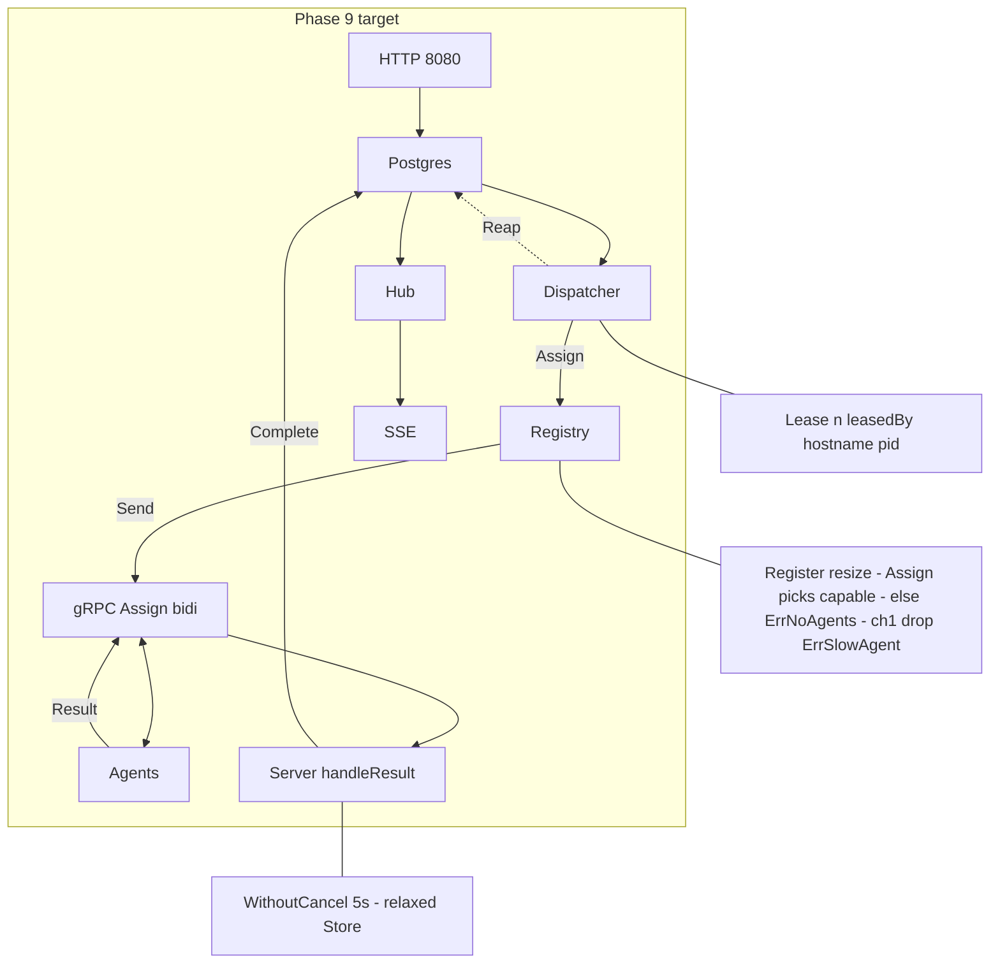
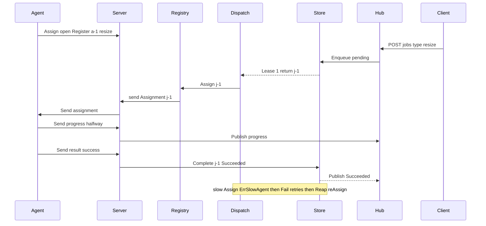
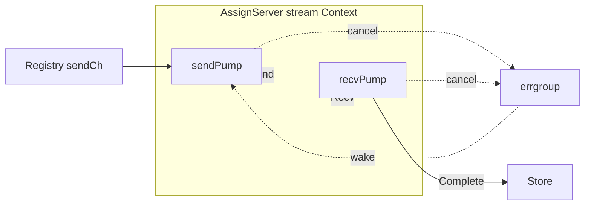

# Phase 9 — gRPC server, registry, and the two-pump stream

**Goal:** `conveyord` accepts agents over a long-lived bidirectional gRPC stream, hands each assignment it leased, and records what the agent sends back — without the dispatch loop knowing agents exist.

*Done when:* `buf` regenerates a `Conveyor.Assign` service, `go test -race ./...` proves a fake agent can receive an `Assignment`, send `Progress`/`Result`, and that a second agent never gets the same job, and `conveyord` serves gRPC alongside HTTP under one `errgroup` root with `GracefulStop` on SIGTERM.

---

## How to read this plan

Same contract as phases 7–8: **tests and configs are given verbatim; implementation is requirements and hints.** Where two answers are defensible the options are argued. Part 0 is a primer — read it first, every task refers back to a numbered section.

---

## Global constraints

Carried from phases 7–8, plus:

1. **No fire-and-forget `go`.** Every `go` in `internal/rpc` has a written owner, a written stop signal, and a written destination for its error. Phase 7's rule, enforced harder here because streams own goroutines that outlive `Assign`'s return.
2. **`internal/rpc` owns no SQL.** It talks to interfaces it declares. The registry is in-memory, dispatch stays on `store.Store`, and `Store` remains the only package that imports `pgx`.
3. **Errors cross the stream as `Result.error string`, not gRPC codes — except transport errors.** `job.ErrNotFound`/`ErrInvalidTransition` become `codes.NotFound`/`FailedPrecondition` only at the gRPC edge, same rule HTTP uses. A `Result` with `error==""` is success, otherwise failure.
4. **At-least-once still holds.** An agent dying mid-stream never loses a job: the lease guarantees it. The server never "completes" a job on behalf of an agent.
5. `buf` remains the contract. Editing `gen/` is a review finding.

---

## Part 0 — The primer

All programs below were run before writing this. Outputs are real.

### 0.1 Bidirectional streaming is one RPC that never returns

```protobuf
service Conveyor {
  rpc Assign(stream AgentToServer) returns (stream ServerToAgent);
}
```

One call, two streams, same TCP connection. The server reads with `stream.Recv()` and writes with `stream.Send()` until either side cancels. There is no request/response pair — the first `Progress` from an agent can arrive before the first `Assignment` from the server.

Why not two unary RPCs (`Poll` + `Report`)? An agent polling every second adds average 500 ms latency to `pending→leased` and doubles reconnect logic (what if `Poll` succeeds and `Report` fails?). One stream gives one place to order, cancel, and retry.

### 0.2 The two-pump pattern — and what deadlocks if you don't

A bidi stream has one reader and one writer, but they cannot be the same goroutine that also does work:

```go
// Wrong: one loop cannot both Send and Recv without blocking on itself.
for {
  msg, _ := stream.Recv() // blocks until agent sends — server can't Send
  stream.Send(&pb.ServerToAgent{...})
}
```

The fix is two goroutines:

```go
g, ctx := errgroup.WithContext(stream.Context())
g.Go(func() error { return sendPump(ctx, stream, assignments) })
g.Go(func() error { return recvPump(ctx, stream, store, hub) })
return g.Wait()
```

`sendPump` selects on `assignments <-chan` and `ctx.Done()`; `recvPump` loops on `Recv()` and dispatches `Heartbeat`/`Progress`/`Result`. Either pump returning cancels `ctx` (via `errgroup`), which wakes the other. **One pump returning nil does not cancel** — see phase 7 §0.2 — so both pumps watch `ctx.Done()` and return `ctx.Err()` when it fires.

What happens if you forget `SetLimit`? Nothing — these two goroutines are the only members, `SetLimit` is unnecessary here. Phase 7 needed it for bounding `MaxInFlight`; here the bound is "one stream = two goroutines".

### 0.3 The registry is a mutex, not a channel manager

```go
type Registry struct {
  mu     sync.Mutex
  agents map[string]*agentConn // keyed by agentID
}
```

An agent registers when `Assign` starts, unregisters when it returns. `AssignJob(job) error` looks up an idle agent, or returns `ErrNoAgents` so the dispatcher can fall back to lease expiry rather than blocking. Using a `chan` per agent (`chan *pb.ServerToAgent` size 1, drop-on-full same as hub) keeps `AssignJob` non-blocking — a slow agent drops an `Assignment` and the store's lease will reclaim it, same at-least-once reasoning as SSE.

No `sync.Map`, no manager goroutine. `map` + `sync.Mutex` is 4 lines and `go test -race` will find the races you would have hidden behind a channel manager.

### 0.4 Context across the stream

`stream.Context()` is cancelled when the client disconnects **or** when the server returns from `Assign`. Every call the server makes for that agent — `store.Complete`/`Fail`, `hub.Publish` — derives from `stream.Context()` or `context.WithoutCancel` for the same reason phase 7 uses it: a `Result` arriving during shutdown must still be recorded. The reaper, not context cancellation, is the correctness mechanism.

### 0.5 `bufconn` and the transcript trap

Testing a bidi stream without a real network:

```go
lis := bufconn.Listen(1 << 20)
srv := grpc.NewServer()
pb.RegisterConveyorServer(srv, myServer)
go srv.Serve(lis)
conn, _ := grpc.NewClient("passthrough://bufnet",
  grpc.WithContextDialer(func(ctx context.Context, _ string) (net.Conn, error) {
    return lis.DialContext(ctx)
  }), grpc.WithTransportCredentials(insecure.NewCredentials()))
client := pb.NewConveyorClient(conn)
stream, _ := client.Assign(ctx)
```

If you buffer a `Result` write and then read an `Assignment`, and both sides use `time.Sleep` to "wait", the test flakes. Synchronize on the return value of `Send`/`Recv`, never on time.

---

## Task 1 — The service

**Goal:** the wire now names the RPC phase 9 will implement.

### Steps

1. Edit `proto/conveyor/v1/conveyor.proto` — add the service block and the minimal agent identity. No other file changes in this task.
2. `make proto`, read `gen/conveyor/v1/conveyor_grpc.pb.go` once — note the `ConveyorClient`/`ConveyorServer` interfaces and that `RegisterService` is generated.
3. `buf lint` + `buf breaking` + `go test ./internal/rpc` must still pass (breaking change is adding a service: allowed per `FILE` rule; adding a variant is also allowed).

### The shape

```protobuf
syntax = "proto3";

package conveyor.v1;

option go_package = "github.com/mddemin/conveyor/gen/conveyor/v1;conveyorv1";

// Added in phase 9: one long-lived stream per agent.
service Conveyor {
  // Assign is the agent's lifeline: the server pushes Assignments,
  // the agent pushes Heartbeats/Progress/Results.
  rpc Assign(stream AgentToServer) returns (stream ServerToAgent);
}

// Existing messages unchanged, except one additive variant:
message AgentToServer {
  oneof payload {
    Heartbeat heartbeat = 1;
    Register  register = 2; // <-- new, occupies reserved gap
    Progress  progress = 5;
    Result    result   = 6;
  }
}

message Register {
  string agent_id    = 1; // client-chosen, e.g. "host-pid"
  repeated string capabilities = 2; // types this agent can execute; empty = any
}

// ServerToAgent, Assignment, CancelJob, Heartbeat, Progress, Result as in phase 8.
```

**Decisions worth writing in the PR:**

* **One service, one RPC.** The registry needs only `Assign`. Adding a separate `Heartbeat` RPC would split liveness across two streams and double reconnect logic — see §0.1.
* **`Register` at field 2, not 7.** It fills the gap left in phase 8. A fresh number would waste the reservation and break the "gaps are intentional" story. Adding a variant is non-breaking; reusing a deleted number would be.
* **No auth in phase 9.** `agent_id` is advisory and used as a map key; real auth arrives in phase 11 with OTel/mTLS. The registry must tolerate duplicate IDs by displacing the old connection (return `AlreadyExists` and close the old stream via its context).

### Done when

Extend `fixtures()` in `internal/rpc/wire_test.go` with `agent_to_server_register` (`Register{agent_id:"a-1", capabilities:["resize"]}`) before regenerating — then `register` appears as `.hex` golden number 7 after `OVERWRITE_GOLDEN=1 go test ./internal/rpc -run TestWireFormatIsFrozen && git add internal/rpc/testdata/*.hex`. `buf lint` passes and `gen/` contains `conveyor.pb.go` + `conveyor_grpc.pb.go`.

---

## Task 2 — The registry

**Goal:** an in-memory, race-safe set of connected agents with non-blocking assignment.

### Shape

```go
package rpc

// Agent holds what the server needs to push to one stream.
type Agent struct {
  ID           string
  Capabilities map[string]struct{}
  send         chan *pb.ServerToAgent // size 1, drop-on-full — see hub pattern
  done         <-chan struct{}        // closed when stream ends
}

type Registry struct { /* mu + map */ }

func NewRegistry() *Registry
func (r *Registry) Register(id string, caps []string, send chan *pb.ServerToAgent) (*Agent, error)
func (r *Registry) Unregister(id string)
func (r *Registry) Get(id string) (*Agent, bool)
func (r *Registry) List() []*Agent // snapshot: returns copy of slice, caller must not mutate
func (r *Registry) Assign(job job.Job) error // picks one idle agent (round-robin or random), Send or drop -> ErrNoAgents if none
var ErrNoAgents = errors.New("no agents available")
var ErrSlowAgent = errors.New("agent is slow")
```


**Requirements:**

* `Register` under `mu`. If `id` exists, close the old `Agent.done` (via cancelling its `Assign` context — see `peerID` in Task 3) and replace the entry; return the new `Agent` with `nil` error. No `ErrAlreadyExists` — displacement is the success path. Tests assert the old send channel is no longer in the registry.
* `List()` returns a snapshot copy (`append([]*Agent(nil), m...)` under `mu`); caller must not mutate. Same reason as `hub` registry.
* `Assign` does not block: `select { case a.send <- msg: default: return ErrSlowAgent }`. The caller (dispatch or test) decides to let the lease expire.
* Capability filtering: if `agent.Capabilities` non-empty, `Assign` only matches `job.Type` contained there; empty means any. If no capable agent, returns `ErrNoAgents`.

**No `Store`, no `hub` in this package.** Registry is pure concurrency; storage and pub/sub are callers. `peerID` helper is defined in Task 3 and used to derive `agentID` from `stream.Context()` + first `Register` payload.

### Tests (verbatim)

```go
func TestRegistryIsConcurrentSafe(t *testing.T) {
  r := NewRegistry()
  var g errgroup.Group
  for i := 0; i < 50; i++ {
    id := fmt.Sprintf("a-%d", i)
    g.Go(func() error { ch := make(chan *pb.ServerToAgent, 1); _, _ = r.Register(id, nil, ch); return nil })
    g.Go(func() error { _ = r.Assign(job.Job{ID: id, Type: "x"}); return nil })
    g.Go(func() error { r.Unregister(id); return nil })
  }
  if err := g.Wait(); err != nil { t.Fatal(err) }
  // -race is the assertion; no data race = pass.
}

func TestAssignDropsForSlowAgent(t *testing.T) {
  r := NewRegistry()
  ch := make(chan *pb.ServerToAgent, 1)
  ch <- &pb.ServerToAgent{Payload: &pb.ServerToAgent_Assignment{Assignment: &pb.Assignment{JobId: "blocked"}}}
  if _, err := r.Register("slow", nil, ch); err != nil { t.Fatal(err) }
  err := r.Assign(job.Job{ID: "j2", Type: "x"})
  if !errors.Is(err, ErrSlowAgent) { t.Fatalf("want ErrSlowAgent, got %v", err) }
}

func TestCapabilityFiltering(t *testing.T) {
  r := NewRegistry()
  fast, _ := r.Register("img", []string{"resize"}, make(chan *pb.ServerToAgent, 1))
  _ = fast
  if err := r.Assign(job.Job{ID: "j1", Type: "resize"}); err != nil { t.Fatalf("capable agent should receive, got %v", err) }
  if err := r.Assign(job.Job{ID: "j2", Type: "transcode"}); !errors.Is(err, ErrNoAgents) { t.Fatalf("want ErrNoAgents, got %v", err) }
}
```

---

## Task 3 — The server: two pumps, one `Assign`

**Goal:** a `ConveyorServer` that implements `Assign(stream Conveyor_AssignServer) error`.

### Shape

```go
type Server struct {
  pb.UnimplementedConveyorServer
  store    Store // subset: Complete, Fail, plus maybe Reap — but not Lease
  hub      Publisher // hub.Publish, same as store.New's Publisher
  registry *Registry
  log      *slog.Logger
  policy   job.Policy
}

// Store is the subset of storage the RPC server needs. Unlike dispatch.Store,
// it does NOT require leasedBy: Job has no LeasedBy field (job.Job:6-14) and
// the lease was taken by the dispatcher (Config.Name), not the agent. The RPC
// path relaxes the WHERE leased_by=$2 check — phase 9 intentionally chooses
// (b) "store relaxes check for rpc path" over (a) "lookup via Get" because Get
// cannot return leasedBy. Documented tradeoff: at-least-once still holds via
// lease expiry, but a stale agent could complete a job already reaped.
type Store interface {
  Complete(ctx context.Context, id string, state job.State, message string) error
  Fail(ctx context.Context, id string, cause error, p job.Policy) (job.Decision, error)
}
type Publisher interface{ Publish(ev job.Event) }

func NewServer(store Store, hub Publisher, reg *Registry, log *slog.Logger, pol job.Policy) *Server
func (s *Server) Assign(stream pb.Conveyor_AssignServer) error
```

Pump split:

```go
func (s *Server) Assign(stream pb.Conveyor_AssignServer) error {
  ctx := stream.Context()
  agentID := peerID(ctx, stream) // first Register payload or p2p address
  send := make(chan *pb.ServerToAgent, 1)
  if _, err := s.registry.Register(agentID, nil, send); err != nil { /* handle duplicate */ }
  defer s.registry.Unregister(agentID)

  g, gctx := errgroup.WithContext(ctx)
  g.Go(func() error { return s.sendPump(gctx, stream, send) })
  g.Go(func() error { return s.recvPump(gctx, stream) })
  return g.Wait()
}

func (s *Server) sendPump(ctx context.Context, stream pb.Conveyor_AssignServer, send <-chan *pb.ServerToAgent) error {
  for {
    select {
    case <-ctx.Done(): return ctx.Err()
    case msg := <-send:
      if err := stream.Send(msg); err != nil { return err }
    }
  }
}
func (s *Server) recvPump(ctx context.Context, stream pb.Conveyor_AssignServer) error {
  for {
    msg, err := stream.Recv()
    if err != nil { return err } // io.EOF means client closed
    switch p := msg.GetPayload().(type) {
    case *pb.AgentToServer_Register: /* update capabilities */ 
    case *pb.AgentToServer_Heartbeat: /* log at debug, no store */
    case *pb.AgentToServer_Progress:  s.hub.Publish(job.Event{JobID: p.Progress.JobId, State: job.Leased, Message: p.Progress.Message})
    case *pb.AgentToServer_Result:    s.handleResult(ctx, p.Result)
    case nil: /* unknown variant from future agent — ignore per TestUnknownVariantIsForwardCompatible */
    }
  }
}
func (s *Server) handleResult(ctx context.Context, r *pb.Result) {
  recCtx, cancel := context.WithTimeout(context.WithoutCancel(ctx), 5*time.Second)
  defer cancel()
  if r.Error == "" {
    _ = s.store.Complete(recCtx, r.JobId, job.Succeeded, "")
  } else {
    _, _ = s.store.Fail(recCtx, r.JobId, errors.New(r.Error), s.policy)
  }
}

// peerID extracts the agent identity: prefer the first Register payload's
// agent_id, fall back to peer.Addr.String() via grpc/peer. Used only to key
// registry.Register; duplicate IDs displace the old stream (see Task 2).
func peerID(ctx context.Context, stream grpc.ServerStream) string { /* ... */ }
```

### Decisions

* **Two pumps sharing `errgroup.WithContext(ctx)`.** A `Send` error (agent gone) cancels `recvPump` via `gctx`; a `Recv` error cancels `sendPump`. Without the shared context, one pump blocks forever.
* **Result handling uses `WithoutCancel` + 5s timeout** — same reasoning as `dispatch.runOne` phase 7. A result that arrived during SIGTERM must still be persisted.
* **Store without `leasedBy` for RPC path.** `Job` has no `LeasedBy` (`job.go:6-14`) and the lease was taken by `dispatch.Config.Name`, not the agent. Forcing `store.Complete(id, leasedBy, …)` would require either extending `Job` or a `jobID→leasedBy` map in the registry. Phase 9 relaxes the check: `rpc.Store` is `Complete(id, state, msg)` / `Fail(id, cause, pol)` without `leasedBy` — at-least-once still holds via expiry/reaper, but a stale agent could complete a just-reaped job. Tradeoff is documented in `Store` comment.
* **Payload `nil` is forward-compat, not an error.** See phase 8 `TestUnknownVariantIsForwardCompatible`. Log at debug and continue.
* **No leasing in this package.** `AssignJob` is how the dispatcher pushes jobs to the registry; the server never calls `store.Lease`. Ownership stays clear: dispatch leases, rpc routes.

### Tests (verbatim)

```go
func TestStreamReceivesAssignment(t *testing.T) {
  ctx := context.Background()
  lis := bufconn.Listen(1 << 20); t.Cleanup(func(){ lis.Close() })
  store := newFakeStore(); hub := newFakeHub(); reg := NewRegistry()
  srv := grpc.NewServer(); pb.RegisterConveyorServer(srv, NewServer(store, hub, reg, slog.Default(), job.Policy{}))
  go srv.Serve(lis); t.Cleanup(srv.Stop)
  conn := dialBufconn(t, lis); client := pb.NewConveyorClient(conn)
  stream, err := client.Assign(ctx); if err != nil { t.Fatal(err) }

  // Simulate dispatch: push one assignment via registry.
  if err := reg.Assign(job.Job{ID: "j-1", Type: "resize"}); err != nil { t.Fatal(err) }

  // Client receives it.
  msg, err := stream.Recv()
  if err != nil { t.Fatal(err) }
  if msg.GetAssignment().GetJobId() != "j-1" { t.Fatalf("want j-1, got %v", msg.GetAssignment()) }
}

func TestResultIsPersisted(t *testing.T) {
  store := newFakeStore(); hub := newFakeHub(); reg := NewRegistry()
  s := NewServer(store, hub, reg, slog.Default(), job.Policy{Base: time.Millisecond})
  ctx := context.Background()
  s.handleResult(ctx, &pb.Result{JobId: "j-1", Error: ""})
  if len(store.completed) == 0 { t.Fatal("expected Complete") }
  s.handleResult(ctx, &pb.Result{JobId: "j-2", Error: "boom"})
  if len(store.failed) == 0 { t.Fatal("expected Fail") }
}

func TestDisconnectUnregisters(t *testing.T) {
  reg := NewRegistry()
  ctx, cancel := context.WithCancel(context.Background())
  lis := bufconn.Listen(1 << 20); srv := grpc.NewServer()
  pb.RegisterConveyorServer(srv, NewServer(newFakeStore(), newFakeHub(), reg, slog.Default(), job.Policy{}))
  go srv.Serve(lis)
  conn := dialBufconn(t, lis); client := pb.NewConveyorClient(conn)
  stream, _ := client.Assign(ctx)
  waitFor(t, func() bool { return len(reg.List()) == 1 })
  cancel(); stream.CloseSend()
  waitFor(t, func() bool { return len(reg.List()) == 0 })
}
```

`newFakeStore`/`newFakeHub` are 20-line in-memory fakes; `dialBufconn` is 8 lines (see §0.5). Reuse `waitFor` from dispatch tests. Run with `-race -count=2`.

---

## Task 4 — Wire it into `conveyord` and retire the `dummyRunner`

**Goal:** one daemon serves HTTP *and* gRPC, dispatch feeds the registry, SIGTERM drains both.

### Steps

1. Add to `cmd/conveyord/main.go`:
   * `flag.String("grpc-addr", ":50051", "gRPC listen address")`
   * `grpc.NewServer()` with `grpc.ChainUnaryInterceptor(logging)`, register `rpc.NewServer`, serve on `net.Listen(*grpcAddr)`.
   * Replace `dummyRunner` with `rpcRunner`:
     ```go
     type rpcRunner struct{ reg *rpc.Registry; log *slog.Logger }
     func (r rpcRunner) Run(ctx context.Context, j job.Job) error {
       if err := r.reg.Assign(j); err != nil {
         // ErrNoAgents / ErrSlowAgent are retryable: Policy.OnFailure (retry.go:45-49) retries any non-Permanent error.
         return fmt.Errorf("assign %s: %w", j.ID, err)
       }
       return nil
     }
     ```
     `Fail` with `job.Policy` will then retry via store, re-lease, and re-assign. No direct `store.Lease` in rpc.
   * Extend `run()`'s `errgroup`: add `g.Go(func() error { return serveGRPC(gctx, lis) })` alongside HTTP `serve`, `dispatcher.Run`, `dispatcher.Reap`. `serveGRPC` wraps `grpcServer.Serve` and returns `GracefulStop` cleanly on context cancel: `<-ctx.Done(); srv.GracefulStop(); return ctx.Err()`.
   * Ordering: `pool.Close()` stays last defer; gRPC and HTTP stop before `dispatcher.Run` returns, which stops leasing. Reuse phase 7 `signal.NotifyContext` stop discipline.

2. `go vet` / `staticcheck -checks=all $(go list ./...|grep -v /gen)` / `gofmt -w .` / `go test -race ./...` green, including new `internal/rpc` tests. `buf lint`/`breaking` still green.

3. Manual demo:
   ```bash
   go run ./cmd/conveyord -dsn ... -grpc-addr :50051 &
   grpcurl -plaintext -d '{"agent_id":"demo"}' localhost:50051 conveyor.v1.Conveyor/Assign
   curl -X POST localhost:8080/jobs -d '{"type":"resize","payload":{"w":10}}'
   # observe Assignment frame arrive on the grpcurl stream
   ```

### Done when

* `conveyord` listens on both `:8080` (HTTP) and `:50051` (gRPC) under one root context; `kill -SIGTERM` drains in-flight jobs (results still recorded via `WithoutCancel`) then `GracefulStop` returns, same semantics as phase 7 HTTP drain.
* `internal/dispatch` `Run` no longer needs `dummyRunner` — the test `TestAFullBatch…` uses a fake `Runner` that calls `reg.Assign`, and `go test -race -count=2 ./internal/rpc ./internal/dispatch` passes.
* No goroutine leaks: `goleak.VerifyTestMain` in `internal/rpc` tests (ignore `bufconn`/`pgx` globals like phase 7).

---

## Phase review checklist

```bash
gofmt -l . | grep -v '^gen/'
go vet ./...
go run honnef.co/go/tools/cmd/staticcheck@latest -checks=all $(go list ./...|grep -v '/gen/')
rm -rf gen && make proto && git diff --stat # repro, now includes conveyor_grpc.pb.go
go test -race ./...
go tool buf lint
go tool buf breaking proto --against '.git#branch=main,subdir=proto'
# + manual: grpcurl stream receives an Assignment for an enqueued job
```

By eye:

* `gen/` contains `conveyor.pb.go` + `conveyor_grpc.pb.go`, nothing else.
* `internal/rpc` imports no `pgx`, no `net/http`; `internal/dispatch` imports no `grpc`.
* `internal/rpc` tests use `bufconn`, no `time.Sleep`, synchronize on channels.
* The `.proto` service comments explain *when* the stream is used, not that it exists.

---

## Appendix — Diagrams (corrected per review)

Target flow — `Dispatch` no longer calls `Complete/Fail` for agent jobs; only `reg.Assign`, `Server.handleResult` does:



*Dispatch no longer calls Complete Fail for agent jobs — only `reg.Assign`; `Server.handleResult` calls `store.Complete Fail`.*

Sequence — capability filter and retry on slow agent:



Two pumps — shared errgroup WithContext:



---

## What phase 10 inherits

A control plane that can `Assign` — the dispatcher now routes leased jobs to streams instead of running them locally. Phase 10 builds the other side: `cmd/agent` that dials `Assign`, executes with bounded concurrency, streams `Progress`/`Result`, honors `CancelJob`, and drains on SIGTERM. The two-pump pattern will appear again, mirrored.
